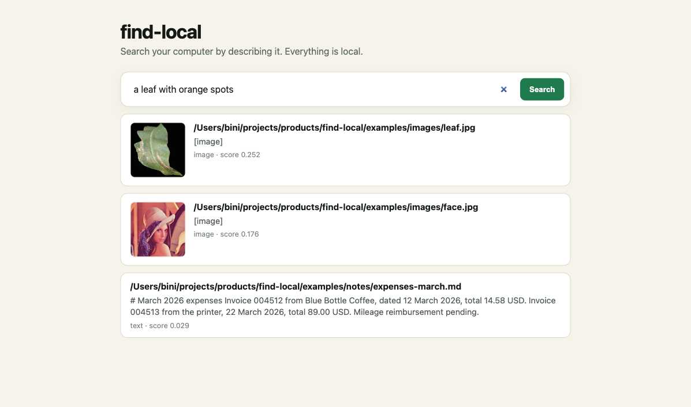

# find-local

[](https://github.com/iambiniyam/find-local/actions/workflows/ci.yml)
[](LICENSE)

Search your files by describing what is in them.

Point find-local at one or more folders. Ask for "the invoice from March", "a dog on a beach", or "that error screenshot". It returns ranked files with snippets and image thumbnails. The index stays on your machine.



Status: v0.2.7. Text search uses Qwen3-Embedding 0.6B. Image search uses SigLIP 2. The interface has filters, keyboard shortcuts, loading states, and dark mode.

## Why

See [how this compares](docs/comparison.md) with self-hosted photo libraries and other local search tools.

Spotlight and Windows Search mostly match file names. They do not know what is inside a PDF or a photo. Cloud search tools can look inside files, but they upload everything first.

find-local builds a local index instead. It handles text files, PDFs, and photos in one query, and ships an MCP server so coding agents can search the same index.

## What is new in 0.2.0

- Qwen3-Embedding 0.6B replaces MiniLM for text and PDFs.
- SigLIP 2 base replaces CLIP for images.
- EmbeddingGemma 2 is available as a single-model alternative: `FIND_EMBEDDER=gemma`.
- Intent-aware score fusion gives visual queries more weight on images and text queries more weight on documents.
- The web interface was rebuilt with filters, keyboard access, loading skeletons, empty states, error recovery, and local-only messaging.
- The server warms both models in the background, so the first search is fast after startup.

Because the vectors changed, an index from 0.1.x must be rebuilt:

```bash
rm ~/.find-local/index.db
find-local index ~/Documents ~/Pictures
```

## Quickstart

```bash
git clone https://github.com/iambiniyam/find-local.git
cd find-local
uv venv && source .venv/bin/activate
uv pip install -e ".[models]"

find-local index ~/Documents ~/Pictures
find-local search "invoice from March"
find-local serve
```

The first index downloads the models. If Hugging Face is slow or blocked, set the mirror and disable the Xet transfer path:

```bash
export HF_ENDPOINT=https://hf-mirror.com
export HF_HUB_DISABLE_XET=1
```

You can also download the model files separately and point find-local at them:

```bash
export FIND_QWEN_EMBEDDING_DIR=/path/to/qwen3-embedding
export FIND_SIGLIP2_DIR=/path/to/siglip2-base
```

## Bundled demo

The repo includes a small corpus in `examples/`: three notes, a PDF, a leaf photo, and a face photo.

```bash
find-local index examples
find-local search "invoice from March"
find-local search "a leaf with orange spots"
find-local serve
```

## Models

| Purpose | Model | Dimensions | Size | License |
|---|---|---|---|---|
| Text and PDF | Qwen/Qwen3-Embedding-0.6B | 1024 | about 1.2 GB | Apache 2.0 |
| Images | google/siglip2-base-patch16-224 | 768 | about 1.5 GB | Apache 2.0 |
| Optional unified | google/embeddinggemma-2 | 768 | about 1.4 GB | Apache 2.0 |

Switch models with `FIND_EMBEDDER`:

```bash
FIND_EMBEDDER=gemma find-local index examples    # one model for text and images
FIND_EMBEDDER=legacy find-local index examples   # MiniLM plus CLIP
FIND_EMBEDDER=hash find-local index examples     # deterministic, for tests
```

Use `--no-images` for a text-only index.

## Benchmark

A small labelled set of 10 queries on the bundled corpus. It is a smoke test, not a public benchmark.

| Stack | Top-1 | Top-3 | MRR | Warm query |
|---|---|---|---|---|
| Qwen3-Embedding 0.6B plus SigLIP 2 | 0.90 | 1.00 | 0.95 | about 0.1 to 0.4 s |
| EmbeddingGemma 2 | 0.80 | 1.00 | 0.90 | about 0.1 to 0.3 s |
| MiniLM plus CLIP | 0.90 | 1.00 | 0.95 | about 0.2 to 1.2 s |

The Qwen and SigLIP pair won on warm latency and uses newer, stronger models for both modalities. See [docs/evaluation.md](docs/evaluation.md) for the queries, method, and caveats.

## CLI

```bash
# index one or more folders
find-local index ~/Documents ~/Downloads ~/Pictures
find-local index ~/Screenshots --ocr  # uv pip install 'find-local[ocr]' first

# search
find-local search "offline privacy notes"
find-local search "beach" --kind image
find-local search "invoice" --limit 5 --json
find-local search "notes" --since 2026-01-01 --until 2026-12-31 --min-size 10KB
find-local search "beach" --kind image --folder ~/Pictures

# keep the index fresh
find-local watch ~/Documents --interval 5

# diagnostics
find-local doctor
```

## Web UI

`find-local serve` opens a local search page with:

- a single search field and a `/` keyboard shortcut
- type filters plus date range, folder prefix, and min/max size
- filename and path relevance for exact names
- a hybrid keyword boost combined with the embedding score
- a polling watcher for incremental indexing
- optional OCR for text inside screenshots and photos, with a process-wide engine cache
- result count and query time
- image thumbnails
- copy path buttons
- loading skeletons, empty states, and retry on errors
- automatic light and dark themes
- visible focus states and reduced-motion support

The page has no external fonts, scripts, or CDNs.

## MCP server

Any MCP client can use the index:

```json
{
  "mcpServers": {
    "find-local": {
      "command": "find-local",
      "args": ["mcp"]
    }
  }
}
```

The server exposes `search_files`, `index_folder`, and `index_stats`.

## How it works

```
folder
  |
  +--> text and PDF chunks --> Qwen3-Embedding --------+
  |                                                     |
  +--> images --------------> SigLIP 2 ----------------+
                                                        |
                                                        v
                                                  SQLite (WAL)
                                                        |
query --> Qwen3 query embedding ------------------------+
      --> SigLIP text embedding -------------------------+
                                                        |
                                                        v
                                     normalized score fusion and ranking
```

Text and image vectors live in separate spaces. Each modality is normalized before merging, and visual queries receive a higher image weight. Chunks keep long PDFs searchable, and results show the best matching chunk.

## Limits

- It does not read text inside images. Search matches visual meaning, not words in a screenshot. OCR is on the roadmap.
- Search is semantic, not exact. For function names and IDs, use ripgrep alongside it.
- The first index is slow on large folders. Embeddings run on CPU or MPS.
- A model change requires a reindex. find-local detects the mismatch and tells you.
- The text model handles many languages, with varying quality.

## Privacy

- No network calls after the models are downloaded.
- The index is a local SQLite file at `~/.find-local/index.db`.
- The web UI binds to 127.0.0.1 by default.
- Thumbnails are served only for paths that are already in the index.

## Tests

```bash
pytest -q
```

The suite has 27 tests, including a Playwright/axe browser check of the initial and empty-search states. and uses a deterministic hash embedder, so it does not download models. It covers indexing, PDF text, incremental updates, the polling watcher, optional OCR chunks, hybrid search, date and size filters, folder filtering, filename relevance, and model mismatch handling.

## Roadmap

- a reranker for the top 20 results
- an encrypted index option
- a recall@10 benchmark on a public file corpus

## Contributing

See [CONTRIBUTING.md](CONTRIBUTING.md).

## Related tools

- [redact](https://github.com/iambiniyam/redact): offline PII redaction for PDFs and photos.
- [snap2sheet](https://github.com/iambiniyam/snap2sheet): receipt and invoice photos to CSV or Excel.
- [shamba](https://github.com/iambiniyam/shamba): offline plant health scanner for gardeners and farmers.

## License

MIT. See [THIRD_PARTY.md](THIRD_PARTY.md) for model and library licenses.
